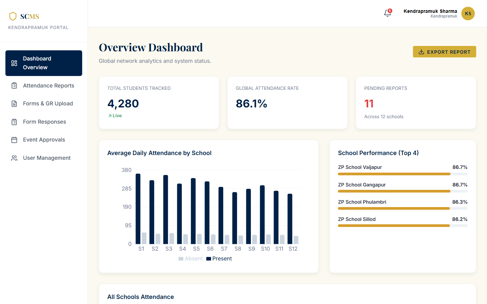
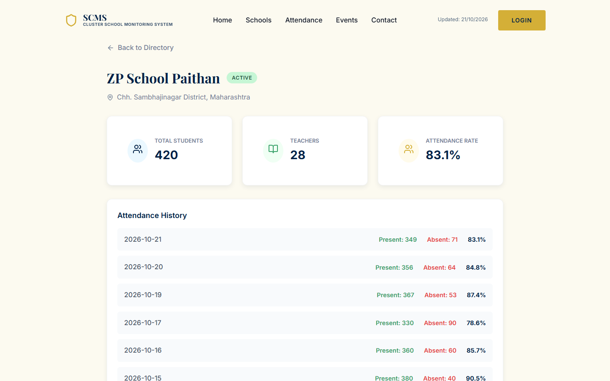
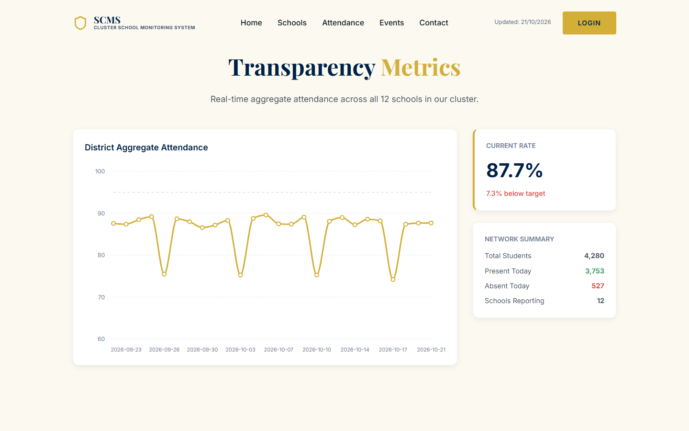
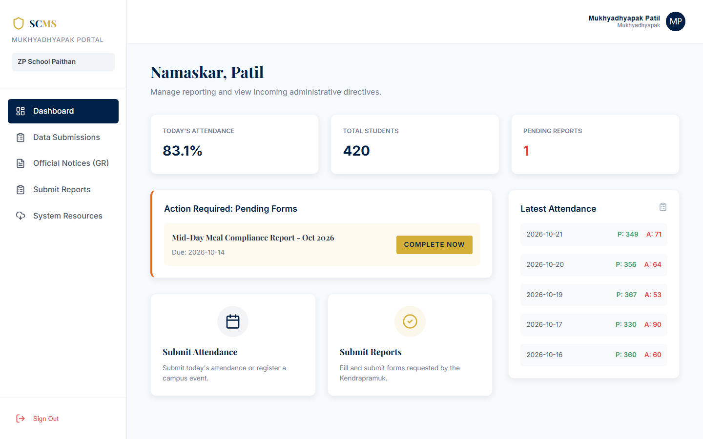
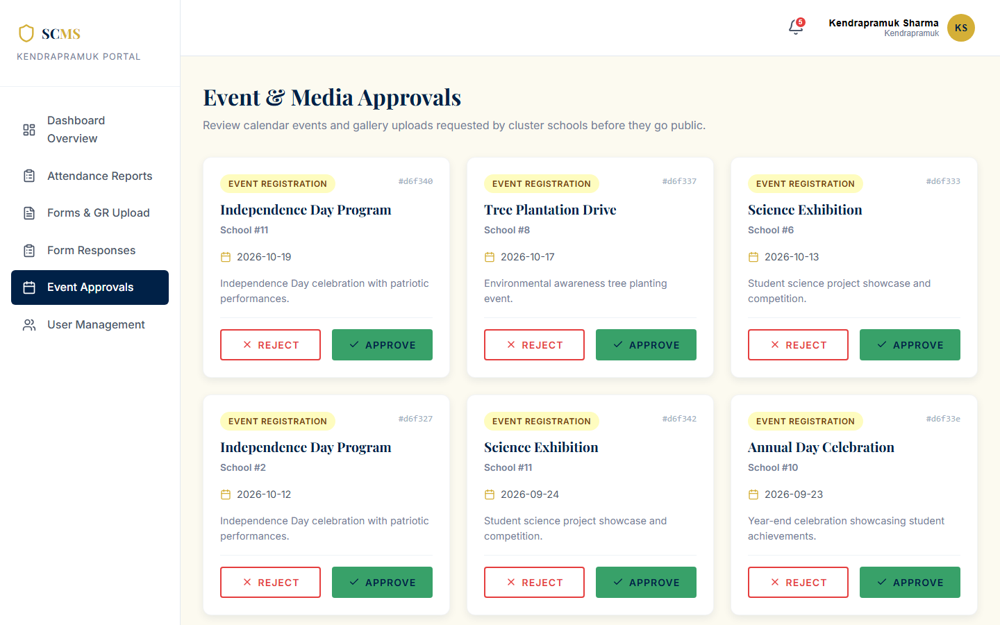
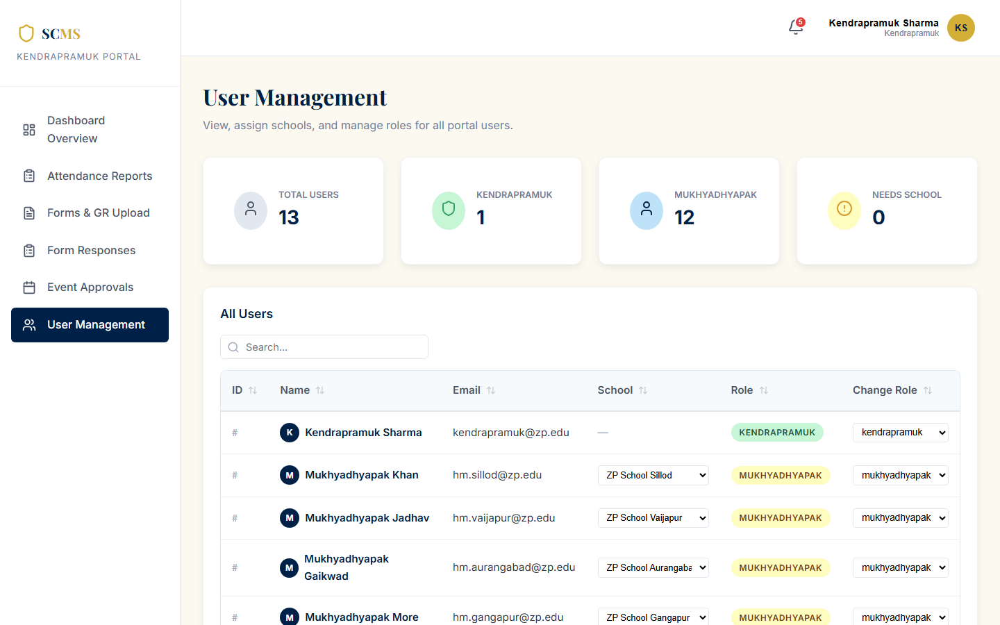
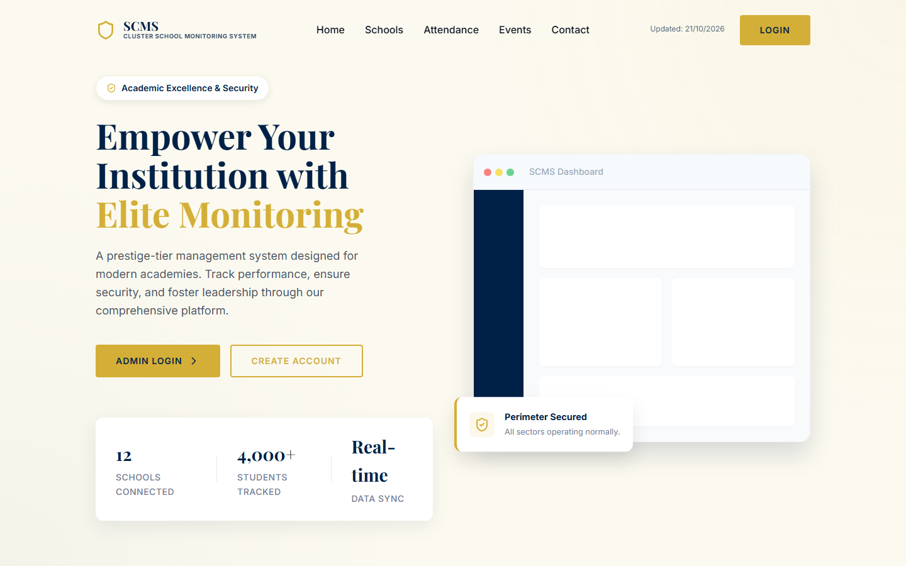

# SCMS — Cluster School Monitoring System

**A web portal for a Kendrapramuk (cluster head) to follow attendance, events, reports and government
resolutions across the Zilla Parishad schools in their cluster, with a public page that shows the same numbers to parents.**

In a Zilla Parishad cluster, one Kendrapramuk looks after about a dozen village schools. Daily attendance, event
plans and compliance reports come in on paper registers, WhatsApp messages and phone calls, and Government
Resolutions (GRs) are passed along as forwarded PDFs. Nobody has one place that answers simple questions:
*which school's attendance dropped this week, which reports are still pending, has every headmaster seen the new GR?*

SCMS gives that one place. Headmasters (Mukhyadhyapaks) log in and submit attendance, events and reports for
**their own school only**. The Kendrapramuk sees the whole cluster, approves events, reviews reports and
publishes GRs. A public side shows the school directory, approved events and aggregate attendance without a login.

The demo is seeded with 12 ZP schools in **Chhatrapati Sambhajinagar district, Maharashtra** (4,280 students).


*Kendrapramuk dashboard on seeded data: enrolment from the school records, attendance rate over all
submitted school-days, and average daily present/absent per school.*

## Who uses it

| Role | Who in real life | What they can do |
|---|---|---|
| **Public** | parents, villagers | school directory and detail pages, approved events, aggregate attendance, gallery, contact form |
| **Mukhyadhyapak** | headmaster of one school | submit daily attendance, register events (go to approval), submit reports, read and download GRs, export own attendance to Excel |
| **Kendrapramuk** | cluster head | cluster-wide attendance and export, approve/reject events, review/flag reports, upload GRs, build forms, assign roles and schools to users, see registration access codes |

Headmasters can sign up themselves, but only with their school's access code, which the Kendrapramuk sees on the
User Management page. Google sign-in also works; a new Google user lands without a school until the Kendrapramuk assigns one.

## Architecture (short version)

```
 Browser ──> Next.js 16 (App Router, React 19)  ── /api/auth/* ──> NextAuth (Google OAuth)
                    │                                                    │ Google ID token
                    │ axios + JWT (Bearer)                               ▼
                    └────────────────────────────────> Express 5 API ── verifies token with Google
                                                          │  auth · RBAC · validation · rate limits
                                         ┌────────────────┼──────────────────┐
                                         ▼                ▼                  ▼
                                  MongoDB Atlas      Cloudinary         Gmail SMTP
                                  (Mongoose)         (GR files)         (Nodemailer)
```

The frontend and the API are deployed separately (Vercel and Render, configs in `vercel.json` and `render.yaml`).
Every permission check happens in the API (`backend/middleware/rbac.js` plus a school-ownership check in the routes),
so hiding a button in the UI is never the only thing standing between a headmaster and another school's data.

## Stack

| Layer | Tool |
|---|---|
| Frontend | Next.js 16 (App Router), React 19, Framer Motion, Recharts, lucide-react |
| Auth | JWT (8 h, bcrypt passwords), NextAuth.js with Google OAuth, ID token verified server-side |
| API | Node.js, Express 5, express-rate-limit |
| Database | MongoDB Atlas via Mongoose 9 |
| Files | Cloudinary through multer-storage-cloudinary (PDF, Word, Excel, images, 10 MB limit) |
| Email | Nodemailer over Gmail SMTP, HTML templates in `backend/emailTemplates.js` |
| Export | SheetJS (`xlsx`) for Excel downloads |
| Tests | `node:test` + mongodb-memory-server, end-to-end over HTTP (`cd backend && npm test`) |

## What it does

- **Attendance:** headmasters submit present/absent/total per day; the API rejects submissions for any school but
  their own. The Kendrapramuk sees every school with a date filter and Excel export; the public page shows the
  latest day's cluster total and a 30-day trend against a 95% target.
- **Events:** a headmaster registers an event, it stays `pending` until the Kendrapramuk approves or rejects it,
  and both sides get an email. Only approved events are visible to the public.
- **Reports:** headmasters submit; the Kendrapramuk gets an email and marks each one reviewed or flagged.
- **GRs (Government Resolutions):** the Kendrapramuk uploads the file to Cloudinary with a GR number and category;
  every headmaster can read and download it.
- **Accounts:** email/password login, Google sign-in, forgot-password email with a one-hour reset link,
  role and school assignment by the Kendrapramuk, auto-logout when the token expires.

## Screenshots

| Public school page | Public attendance |
|---|---|
|  |  |
| Each school's enrolment, staff and attendance history, open to anyone. Access codes are never sent to the public endpoints. | Latest day across all 12 schools, plus the 30-day trend. The dips are Saturdays, which the seed data sets lower on purpose. |

| Headmaster dashboard | Event approvals |
|---|---|
|  |  |
| A Mukhyadhyapak only ever sees their own school: today's attendance, enrolment, pending forms and the latest submissions. | Events from all schools wait here until the Kendrapramuk approves or rejects them. |

| User management | Landing page |
|---|---|
|  |  |
| Change roles, assign schools to Google sign-ups, and copy each school's registration access code. | Public entry point with login and headmaster registration. |

## What was checked

These run in `backend/test/api.test.js` against a real MongoDB (in memory), with the server seeding itself the
same way it does in production:

| Check | Result |
|---|---|
| Seeded demo accounts log in (Kendrapramuk and a Mukhyadhyapak) | pass |
| Public school list and detail pages never include access codes | pass |
| Public visitors only see approved events, even with `?status=pending` | pass |
| `/api/auth/google` ignores an email sent in the body; a fake ID token gets 401 | pass |
| Registration only accepts the access code stored on that school | pass |
| A headmaster cannot submit or read another school's attendance | pass |
| Report status only accepts known values | pass |
| Unknown or expired password-reset tokens are rejected | pass |
| Protected routes return 401 without a token and 403 for the wrong role | pass |

`npm run build` and `npm run lint` (0 errors) pass for the frontend. With `NODE_ENV=production` the API
refuses to start without a `JWT_SECRET`.

## Running it

You need Node.js 18 or newer, a MongoDB connection string (a free Atlas M0 cluster is enough) and, for the
optional parts, a Cloudinary account, a Gmail App Password and a Google OAuth client.

```bash
# backend (terminal 1)
cd backend
cp .env.example .env          # fill in MONGODB_URI and JWT_SECRET at least
npm install
npm run dev                   # http://localhost:5000, seeds the database on first start

# frontend (terminal 2)
cp .env.example .env.local
npm install
npm run dev                   # http://localhost:3000

# tests (first run downloads a MongoDB binary, ~600 MB, then it is cached)
cd backend && npm test

# wipe and re-seed the database
cd backend && node reseed.js
# upload placeholder GR files to Cloudinary and link them to the seeded GRs
cd backend && node seedFiles.js
```

Without Cloudinary, GR upload fails but everything else works. Without Gmail, the app works and the emails just
fail in the server log. Without a Google client, use email/password.

### Demo accounts

| Role | Email | Password |
|---|---|---|
| Kendrapramuk | `kendrapramuk@zp.edu` | `admin123` |
| Mukhyadhyapak, ZP School Paithan | `hm.paithan@zp.edu` | `hm123` |
| Mukhyadhyapak, ZP School Kannad | `hm.kannad@zp.edu` | `hm123` |

All 12 headmasters follow `hm.<taluka>@zp.edu` / `hm123`: paithan, kannad, phulambri, sillod, vaijapur, gangapur,
khuldabad, soegaon, aurangabad, jalnaroad, begumpura, waluj. These are for local demos only; change them before
putting real data in.

### Environment

| File | Variables |
|---|---|
| `.env.local` (frontend) | `NEXT_PUBLIC_API_URL`, `NEXTAUTH_URL`, `NEXTAUTH_SECRET`, `GOOGLE_CLIENT_ID`, `GOOGLE_CLIENT_SECRET` |
| `backend/.env` | `PORT`, `NODE_ENV`, `JWT_SECRET`, `ALLOWED_ORIGIN`, `MONGODB_URI`, `GOOGLE_CLIENT_ID`, `CLOUDINARY_*`, `MAIL_USER`, `MAIL_PASS`, `MAIL_FROM` |

Both have a commented `.env.example`. `GOOGLE_CLIENT_ID` must be the same in both: the API uses it to check that
a Google ID token was issued for this app.

## API

| Route | Who | What |
|---|---|---|
| `POST /api/auth/login`, `/register`, `/google`, `/forgot-password`, `/reset-password` | public (rate limited) | sign in, sign up with access code, Google exchange, password reset |
| `GET /api/auth/me` | logged in | current user |
| `GET /api/schools`, `/api/schools/:id` | public | directory, without access codes |
| `GET /api/schools/admin/access-codes` | Kendrapramuk | registration codes |
| `GET /api/attendance` | public / scoped | all schools, or only your own when logged in as a headmaster |
| `POST /api/attendance` | Mukhyadhyapak | own school only |
| `GET /api/events` · `POST` · `PATCH /:id/status` | public sees approved / Mukhyadhyapak creates / Kendrapramuk decides | event workflow |
| `GET /api/reports` · `POST` · `PATCH /:id/status` | scoped / Mukhyadhyapak / Kendrapramuk | report workflow |
| `GET /api/gr` · `POST` · `DELETE /:id` | both roles read / Kendrapramuk writes | GR documents |
| `GET /api/forms` · `POST` | both roles read / Kendrapramuk writes | form templates |
| `GET /api/users` · `PATCH /:id/role` · `PATCH /:id/school` | Kendrapramuk | user management |
| `GET /api/notifications` · `PATCH /:id/read` | Kendrapramuk | notification bell |
| `POST /api/contact` | public (rate limited) | contact form, stored and emailed |
| `GET /api/health` | public | health check for Render |

## Deployment

- **API on Render:** `render.yaml` defines the service (root `backend`, `npm start`, health check `/api/health`).
  Set the secrets in the Render dashboard and point `ALLOWED_ORIGIN` at the frontend URL.
- **Frontend on Vercel:** import the repo with the root as the project directory, add the `.env.local` variables,
  and set `NEXT_PUBLIC_API_URL` to the Render URL plus `/api`.
- **Google OAuth:** add `https://<your-vercel-app>.vercel.app/api/auth/callback/google` as a redirect URI.

## Docs

| Doc | About |
|---|---|
| [docs/nextjs-migration.md](docs/nextjs-migration.md) | how the app was moved from a Vite + React Router SPA to the Next.js App Router |

## Project status

**Working end to end** for the two roles and the public side, on seeded data.

**Limits, honestly:**
- All data is **seeded and synthetic**: 12 real taluka names, but made-up enrolment, 30 days of generated
  attendance (Saturdays lower), and random events and reports. It has not been used by a real cluster.
- The **notification bell shows seeded messages only**; events and reports send emails but do not create notifications yet.
- The **Form Builder saves templates, but the headmaster side does not load them yet**; headmasters fill the report
  list instead. **Gallery upload** shows "coming soon".
- Event and report emails go to the **first Kendrapramuk** in the database; the app assumes one cluster per deployment.
- Access codes are **fixed per school** in the seed, with no rotation from the UI.
- The JWT is kept in `localStorage`, which is simpler than httpOnly cookies but readable by any script on the page.
- There are API tests but **no frontend tests**.
